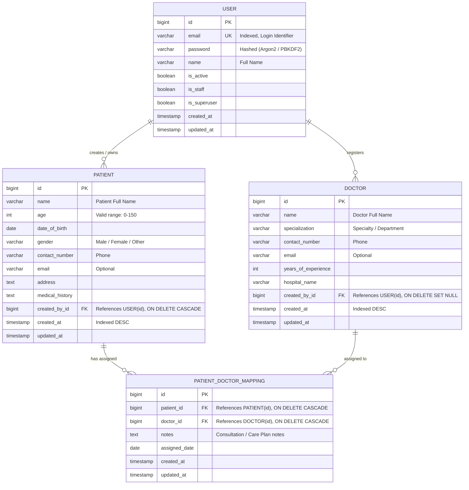
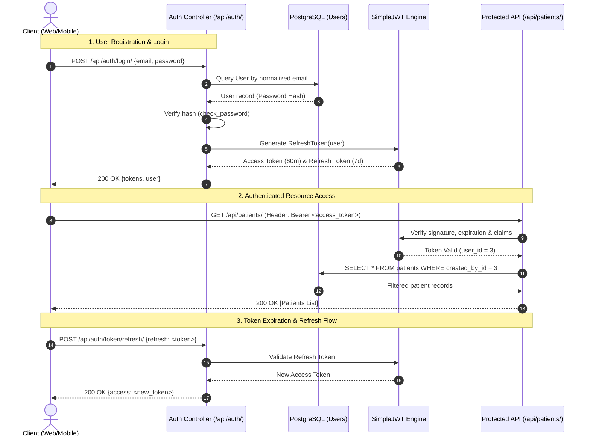
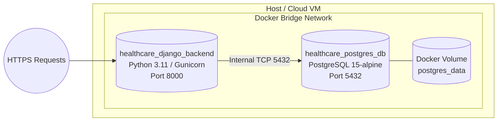

# System Architecture & Technical Design Document

## 1. Executive Overview

The **Healthcare Backend System** is an enterprise-grade RESTful API backend engineered using **Django 6**, **Django REST Framework (DRF)**, **PostgreSQL 15+**, and **SimpleJWT**. It delivers a high-security, scalable architecture for managing electronic medical records, clinical registries, and care team assignments.

### Core Architecture Highlights
- **Decoupled Domain Architecture**: Clean separation of domain concerns into dedicated Django applications (`authentication`, `patients`, `doctors`, `mappings`).
- **Stateless JWT Security**: Asymmetric/Symmetric claims validation using `djangorestframework-simplejwt`, eliminating server-side session overhead.
- **Strict Data Isolation**: Role-aware tenant isolation ensuring medical practitioners only view and mutate patient records they created.
- **Relational Integrity**: Strongly typed database schemas enforced at the PostgreSQL layer through foreign keys, indices, and composite unique constraints.
- **Standardized Error Contracts**: Centralized exception handling yielding predictable JSON payloads for consistent client-side error handling.
- **API Spec & Observability**: Interactive OpenAPI 3.0 / Swagger documentation (`drf-spectacular`) and real-time database health monitoring (`/api/health/`).

---

## 2. High-Level System Architecture Diagram

```mermaid
graph TD
    subgraph Client Layer
        WebClient["Web Application (React / Next.js)"]
        MobileClient["Mobile Client (iOS / Android)"]
        APIClients["API Clients / Postman"]
    end

    subgraph Gateway & Security
        Nginx["Reverse Proxy / Nginx / ALB"]
        CORS["CORS Middleware"]
        JWTMiddleware["JWT Authentication Filter"]
    end

    subgraph Application Layer (Django + DRF)
        Router["Django URL Dispatcher"]
        subgraph Apps
            AuthApp["authentication<br/>• User Model<br/>• Registration & Login<br/>• JWT Token Generation"]
            PatientsApp["patients<br/>• Patient CRUD<br/>• User Scoped QuerySet"]
            DoctorsApp["doctors<br/>• Doctor Registry<br/>• Search & Filters"]
            MappingsApp["mappings<br/>• Patient-Doctor Link<br/>• Unique Constraints"]
        end
        ExceptionHandler["Standardized Custom Exception Handler"]
    end

    subgraph Data & Storage Layer
        Postgres[(PostgreSQL 15+<br/>healthcare_db)]
        PostgresVolumes[("Docker Persistent Storage Volume")]
    end

    ClientLayer --> Nginx
    Nginx --> CORS
    CORS --> JWTMiddleware
    JWTMiddleware --> Router
    Router --> AuthApp
    Router --> PatientsApp
    Router --> DoctorsApp
    Router --> MappingsApp
    Apps --> ExceptionHandler
    Apps -->|psycopg3 Connection Pool| Postgres
    Postgres --- PostgresVolumes
```

---

## 3. Database Design & Entity Relationship Diagram (ERD)

The database schema is modeled to guarantee strict data integrity, fast index-assisted query resolution, and referential safeguards against orphaned records.



### Relational Integrity Rules:
1. **User Identity**: The `User` entity enforces unique emails with case-insensitive normalization. Passwords utilize Django's cryptographically salted hashers.
2. **Patient Ownership**: `Patient.created_by` has an `ON DELETE CASCADE` constraint. If a doctor user account is removed, its associated patient pool is protected or deleted according to tenant privacy mandates.
3. **Doctor Registry**: `Doctor.created_by` uses `ON DELETE SET NULL`. If the staff member who entered the doctor's record is removed, the doctor's global record remains active in the hospital registry.
4. **Composite Uniqueness on Mappings**: `unique_together = ('patient', 'doctor')` prevents redundant assignments of the same physician to the same patient.
5. **Cascading Mapping Cleanup**: Deleting either a `Patient` or a `Doctor` automatically cascades to delete the corresponding mapping records, preventing dangling references.

---

## 4. Modular Component Breakdown

```
healthcare_project/
├── manage.py
├── healthcare_project/          # Project Root Configuration
│   ├── settings.py              # 12-Factor config, PostgreSQL connection, JWT tuning
│   ├── urls.py                  # API routing, Swagger UI, ReDoc, Healthcheck
│   ├── exceptions.py            # Global JSON exception handler
│   └── wsgi.py / asgi.py        # Gateway interfaces
├── authentication/              # Identity & Access Management
│   ├── models.py                # CustomUser (Email-first authentication)
│   ├── serializers.py           # RegisterSerializer, LoginSerializer, UserSerializer
│   ├── views.py                 # RegisterView, LoginView, CurrentUserView
│   └── urls.py                  # /api/auth/* endpoints
├── patients/                    # Electronic Health Records (EHR)
│   ├── models.py                # Patient entity with clinical demographics
│   ├── serializers.py           # PatientSerializer with input validation
│   ├── views.py                 # PatientListCreateView, PatientDetailView (User Scoped)
│   └── urls.py                  # /api/patients/* endpoints
├── doctors/                     # Physician Registry
│   ├── models.py                # Doctor entity with specialization & experience
│   ├── serializers.py           # DoctorSerializer
│   ├── views.py                 # DoctorListCreateView, DoctorDetailView
│   └── urls.py                  # /api/doctors/* endpoints
└── mappings/                    # Patient-Doctor Care Assignments
    ├── models.py                # PatientDoctorMapping with unique constraints
    ├── serializers.py           # Read & Write mapping serializers
    ├── views.py                 # MappingListCreateView, MappingDetailOrPatientView
    └── urls.py                  # /api/mappings/* endpoints
```

---

## 5. Security & Authentication Architecture



### Authentication Invariants:
- **Zero Raw Passwords**: Passwords never enter application logs or database tables in plaintext.
- **Short-Lived Access Tokens**: Configured by default to 60 minutes via `ACCESS_TOKEN_LIFETIME_MINUTES`.
- **Sliding Refresh Tokens**: Valid for 7 days via `REFRESH_TOKEN_LIFETIME_DAYS`.
- **Claim Integrity**: User ID is stored inside the cryptographically signed JWT payload (`user_id`), allowing zero-roundtrip validation on cached pipelines.

---

## 6. Multi-Tenant Data Isolation Strategy

A core clinical safety requirement in healthcare applications is multi-tenancy isolation. In this application:
- When a practitioner calls `GET /api/patients/`, the queryset is dynamically resolved as:
  ```python
  patients = Patient.objects.filter(created_by=request.user)
  ```
- When accessing a specific patient record (`GET /api/patients/<id>/`, `PUT`, `DELETE`):
  ```python
  def get_object(self, pk, user):
      if user.is_staff or user.is_superuser:
          return get_object_or_404(Patient, pk=pk)
      return get_object_or_404(Patient, pk=pk, created_by=user)
  ```
- **Security Guarantee**: Attempting to query or modify an ID created by another medical user returns a `404 Not Found` rather than `403 Forbidden`. This defends against **ID enumeration attacks** (Indirect Object Reference / IDOR).

---

## 7. Standardized Error Handling Architecture

All exceptions (validation, authentication, authorization, not found, server errors) are channeled through `healthcare_project.exceptions.custom_exception_handler`.

### Unified Error Schema
```json
{
  "success": false,
  "status_code": 400,
  "error": {
    "message": "Validation or request processing error.",
    "details": {
      "email": [
        "A user with this email address already exists."
      ]
    }
  }
}
```

This guarantees client software always has a single uniform error envelope to parse across all API routes.

---

## 8. Deployment Architecture (Docker & Production)



- **Healthchecks**: PostgreSQL runs a native `pg_isready` probe. The Django container only initiates migrations and boots after PostgreSQL reports healthy.
- **Automated Bootstrap**: Docker Compose automatically applies pending migrations and triggers the database seeder on initial run.
